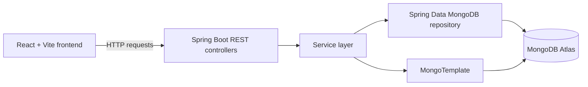

# Movie Review Application

A full-stack movie browsing and review application built with **React, Java, Spring Boot, and MongoDB**. The project connects a React frontend to REST APIs implemented with Spring Boot, with movie and review data stored in MongoDB Atlas.

> **Project status:** The current development phase is complete, but the application has **not been deployed**. It is intended to run locally.

## Features

### Movie discovery

- Browse a movie collection with posters and key information.
- Search movie titles using partial, case-insensitive matching.
- Filter movies by available genres.
- Sort movies by title (A–Z or Z–A) and release date (newest or oldest).
- Combine search, genre filtering, and sorting.
- Display a helpful empty state when no movies match the search.

### Movie details

- Open a dedicated page for each movie at `/movies/:imdbId`.
- View movie information, including its title, release date, and genres.
- Open the movie's trailer link.
- Browse a scene/backdrop gallery.

### Reviews

- Submit a review for a movie.
- Retrieve and display existing reviews linked to a movie through its `reviewIds`.
- Display a newly submitted review immediately without refreshing the page.
- Show submission feedback and a temporary `Submitting...` state.
- Disable submission while a request is processing or the text is empty/whitespace-only.
- Limit each review to 500 characters and display a live character counter.
- Display the current review count.

### Usability and reliability

- Responsive layout improvements for desktop, tablet, and mobile screens.
- Loading, error, and empty-result feedback.
- Defensive handling for missing or malformed movie and review data.
- Cancellation of obsolete movie requests using `AbortController`.
- Keyboard focus visibility and consistent styling across controls.

## Technology stack

| Area | Technologies |
|---|---|
| Frontend | React, Vite, JavaScript, CSS |
| Routing | React Router |
| Backend | Java 21, Spring Boot, Spring MVC REST controllers |
| Data access | Spring Data MongoDB, `MongoTemplate` |
| Database | MongoDB Atlas |
| API testing | Postman and manual browser testing |
| Development tools | IntelliJ IDEA, Visual Studio Code, Git, GitHub |

## Architecture

The application separates the frontend, API layer, business logic, and persistence layer.



### Request flow

1. The React application sends an HTTP request to a Spring Boot REST endpoint.
2. A controller receives the request and calls the relevant service method.
3. The service uses a repository or `MongoTemplate` to interact with MongoDB.
4. Spring Boot returns the response, and React updates the interface.

For reviews, each movie stores review IDs in `reviewIds`. The frontend reads those IDs and requests each review through the review-by-ID endpoint.

## Project structure

```text
movie-review-application/
├── Data/                 # Movie dataset used during development
├── backend/              # Java and Spring Boot application
│   ├── src/
│   ├── pom.xml
│   └── src/main/resources/application.properties
├── frontend/             # React + Vite application
│   ├── src/
│   ├── package.json
│   └── ...
├── PROJECT_DOCUMENTATION.md
├── API_DOCUMENTATION.md
├── INTERVIEW_PREPARATION.md
└── README.md
```

The three additional Markdown documents cover the project architecture and implementation, API behavior, and interview preparation. Include them in the repository if they are currently only in your local project folder.

## Run locally

### Prerequisites

Install or prepare the following:

- **Java 21**
- **Maven**
- **Node.js and npm** (use a version compatible with the Vite version in `frontend/package.json`)
- A **MongoDB Atlas** cluster and database user
- Git

### 1. Clone the repository

```bash
git clone https://github.com/ManideepNunna8096/movie-review-application.git
cd movie-review-application
```

### 2. Prepare MongoDB Atlas

1. Create or select a MongoDB Atlas cluster.
2. Create a database user with permission to read and write the application database.
3. Allow your development machine's IP address in the Atlas network access settings.
4. Use the movie dataset in the `Data/` directory to populate the `movie-api-db` database and its `movies` collection if the collection is not already populated. MongoDB Compass can be used to inspect or import the data.

The default database name in the backend configuration is `movie-api-db`.

### 3. Configure backend environment variables

Create a local `.env` file inside the `backend/` directory. Use your own Atlas connection details:

```dotenv
MONGO_USER=your_database_username
MONGO_PASSWORD=your_database_password
MONGO_CLUSTER=your-cluster-host.mongodb.net
MONGO_DATABASE=movie-api-db
```

The backend builds its MongoDB connection URI from these variables. `MONGO_DATABASE` defaults to `movie-api-db` when omitted.

**Security note:** Never commit real database usernames, passwords, connection strings, or other secrets. Keep `.env` local and confirm that it is excluded from Git. If your password contains special characters that are not valid in a URI, encode them as required by MongoDB connection-string rules.

### 4. Start the Spring Boot backend

From the repository root:

```bash
cd backend
mvn spring-boot:run
```

The backend is expected to run at:

```text
http://localhost:8080
```

You can verify the movie collection endpoint in a browser or API client:

```text
GET http://localhost:8080/api/v1/movies
```

You can also open the backend project in IntelliJ IDEA and run its Spring Boot application class.

### 5. Start the React frontend

Open a second terminal from the repository root:

```bash
cd frontend
npm install
npm run dev
```

Vite normally serves the frontend at:

```text
http://localhost:5173
```

Open that address in your browser. The current frontend API calls are configured for the local backend at `http://localhost:8080`. The review controller also allows the local Vite origin for cross-origin requests.

## REST API reference

Base URL for local development: `http://localhost:8080`

| Method | Endpoint | Purpose |
|---|---|---|
| `GET` | `/api/v1/movies` | Retrieve the movie collection. |
| `GET` | `/api/v1/movies/{imdbId}` | Retrieve a movie by its IMDb ID. |
| `POST` | `/api/v1/reviews` | Create a review and associate it with a movie. |
| `GET` | `/api/v1/reviews/{reviewId}` | Retrieve an individual review by its MongoDB ID. |

### Create a review

`POST /api/v1/reviews`

Request body:

```json
{
  "reviewBody": "I really enjoyed this movie!",
  "imdbId": "tt3915174"
}
```

The backend saves the review and associates its ID with the corresponding movie. The `imdbId` must refer to a movie present in the database.

### Retrieve a review

`GET /api/v1/reviews/{reviewId}`

Use a review ID stored in the movie's `reviewIds` array. The endpoint returns the review when it is found and a `404 Not Found` response when no matching review is found.

## Movie data model

Movie documents include fields used by the frontend such as:

- `imdbId` — movie identifier used in routes and API requests
- `title` — movie title
- `releaseDate` — release date
- `trailerLink` — trailer URL
- `poster` — poster URL
- `genres` — available genres
- `backdrops` — scene/backdrop image URLs
- `reviewIds` — IDs of reviews associated with the movie

Review documents store the review body and MongoDB ID. The frontend uses the movie's `reviewIds` to request the associated reviews individually.

## Verification and quality checks

The project was manually exercised through the frontend and API workflows. Checks included movie-list and movie-detail retrieval, review creation and retrieval, search/filter/sort behavior, empty search results, and relevant loading/error states.

Frontend quality checks:

```bash
cd frontend
npm run lint
npm run build
```

Git whitespace/error check, from the repository root:

```bash
git diff --check
```

These checks do not imply that a comprehensive automated test suite exists. Automated tests remain a planned improvement.

## Documentation

- **`PROJECT_DOCUMENTATION.md`** — architecture, technology stack, components, database, error handling, testing, and limitations.
- **`API_DOCUMENTATION.md`** — endpoint details and request/response behavior.
- **`INTERVIEW_PREPARATION.md`** — project explanation, technical questions, debugging scenarios, design decisions, and revision notes.

## Known limitations and future improvements

The current development phase focuses on the core browsing and review experience. Potential next steps include:

- User authentication and authorization
- Stronger server-side validation and review ownership rules
- Automated backend and frontend tests
- Pagination for larger movie collections
- Production configuration and deployment

**This application has not been deployed.** It currently uses local frontend/backend addresses and requires MongoDB configuration to run in a development environment.

## Learning resources and acknowledgment

This project was developed as a hands-on learning project while following freeCodeCamp's course, [Full Stack Development with Java Spring Boot, React, and MongoDB](https://www.youtube.com/watch?v=5PdEmeopJVQ). The backend section is taught by Farhan Hasin Chowdhury and the frontend section by Gavin Lon. I used the course as a learning foundation and extended the application with additional movie discovery, review UI, responsive design, data handling, and documentation work.

---

Thank you for checking out the project!
